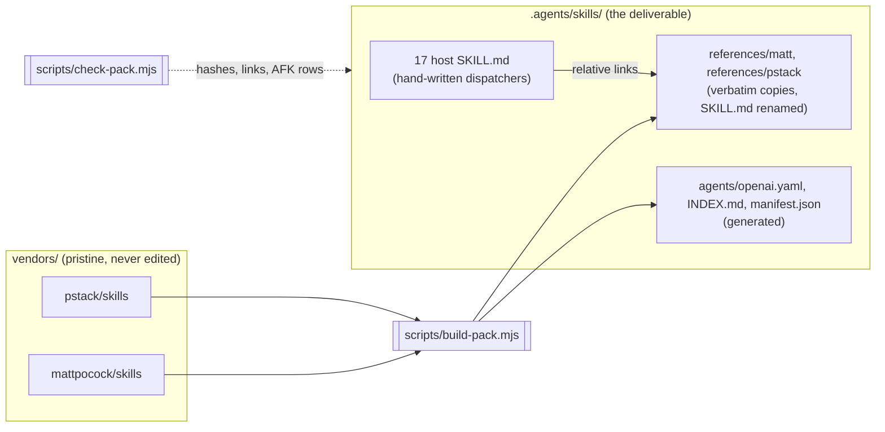
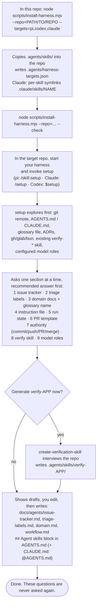
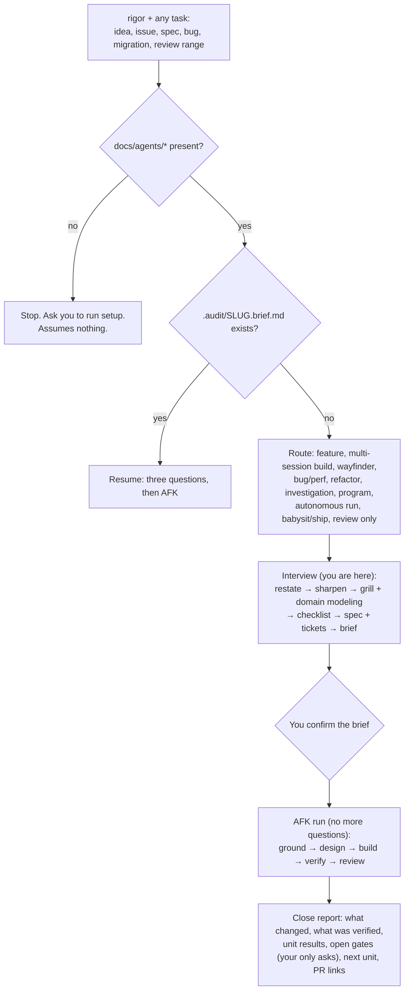
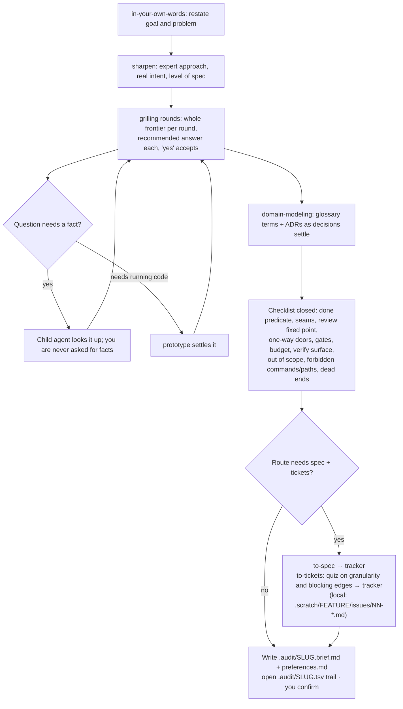
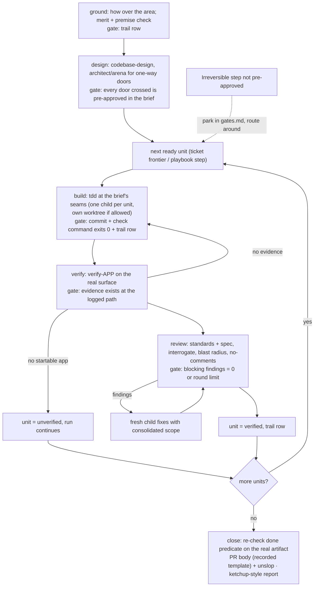
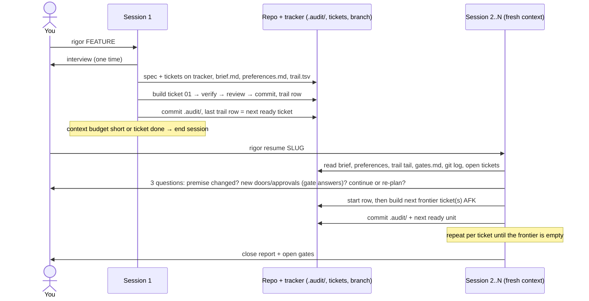
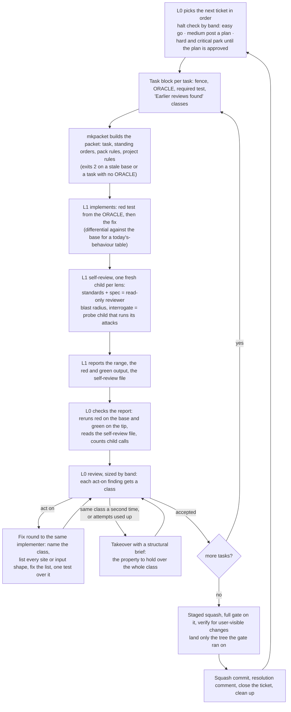

# rigor-pack

One merged agent-skills pack built from two upstream collections, with one workflow. It installs into any repo and runs on **pi**, **OpenAI Codex CLI** and **Claude Code** from the same files.

- [mattpocock/skills](https://github.com/mattpocock/skills) (engineering lifecycle: grill → spec → tickets → implement → review → retro)
- [pstack](https://github.com/cursor/plugins/tree/main/pstack/skills) (playbooks, principles, adversarial review, decision trails, autonomy)

You need two names: run **`setup`** once per repo, then give every task to **`rigor`**. `rigor` interviews you once at the start. After that the run is AFK: it plans, builds, verifies and reviews without asking you anything, and parks anything irreversible as a gate for you to answer at the end.

## Repo rules

1. **`vendors/` is never edited by hand.** It only ever holds an exact upstream copy at the pinned commit. To change it, replace the whole subset with the latest upstream (see [Upgrading upstream](#upgrading-upstream)) and bump the pin. Every change to what the pack says goes in hand-written files or in `scripts/harness-neutral.mjs` (see [CHANGES.md](CHANGES.md) rules 3 and 7).
2. **Never edit a copy under `.agents/skills/*/references/matt/` or `references/pstack/`.** The build regenerates them, and the check flags any edit.
3. **The pack names no project and no delegation tool in its method.** Project settings live in the target repo's `docs/agents/workflow.md`. A delegation tool appears only in its adapter, `rigor/delegation/<tool>.md`.
4. **Never use fast-mode models**, for any role.

## The pack: 17 skills

| Skill | Who invokes it | What it is for |
|---|---|---|
| `rigor` | you | The one workflow: route, interview, AFK run, resume, close |
| `setup` | you, once per repo | Every repo-level question, answered once into `docs/agents/` |
| `triage` | you | Move incoming issues through triage roles (human-present) |
| `handoff` | you | Hand off, pause, or pick up work |
| `retro` | you | Retro, reflect, correct, automate-me |
| `wait-what` | you | Re-pitch the last message, or catch up |
| `teach` | you | Explain code, or a multi-session learning workspace |
| `grilling` | model or you | Interview primitive (restate, sharpen, grill, questionnaire) |
| `domain-modeling` | model or you | Glossary, ADRs, model-the-domain |
| `codebase-design` | model or you | Deep modules, architect, arena, 11 design principles, TypeScript |
| `tdd` | model or you | Red-green at agreed seams; bug regression tests |
| `diagnosing-bugs` | model or you | Diagnosis loop, bug/perf/hillclimb/forensics playbooks |
| `code-review` | model or you | Standards + spec, interrogate, blast radius, comments, bot triage |
| `verify` | model or you | Prove it works; create/maintain `verify-<app>`; formal verification; benchmark checklist |
| `research` | model or you | Research, how, why, recall |
| `prototype` | model or you | Throwaway code that answers one design question |
| `writing` | model or you | Writing for agents, PR bodies, technical writing, unslop |

Each host `SKILL.md` is a short hand-written dispatcher. The upstream bodies it uses are copied verbatim under `references/matt/` and `references/pstack/`, and the dispatcher links to them by relative path. All 85 upstream skills are accounted for (81 copied, `make-bot-ui`, `poteto-help` and `ketchup-video` dropped, and a one-line alias resolved into the skill it names); see [CHANGES.md](CHANGES.md).



## 1. First-time setup



## 2. Giving it a task



## 3. Planning (the interview)



## 4. Implementing (the AFK run)



Mid-run rules ([rigor/AFK.md](.agents/skills/rigor/AFK.md)): a reversible ambiguity gets the conservative choice and a logged reason. An unapproved irreversible step becomes a gate. A missing harness feature gets the documented fallback, logged as `degraded: ...`. Unit results are only `verified`, `unverified`, `blocked`, `reverted` or `skipped`.

## 5. Implementing across separate sessions



Planning and building share a session by default (Continue is the first branch to rule out). Start a fresh session per ticket for multi-session builds, when the context budget is short, or for a wayfinder effort. State never lives in chat: a fresh session in any clone reaches full working state from `.audit/`, the tracker and git. To move to another harness or a colleague mid-phase, use `handoff`.

## 6. Chain runs

A recorded chain of tickets resumes with `continue <slug>`: [rigor/CHAIN.md](.agents/skills/rigor/CHAIN.md) runs the tickets back to back, AFK, until a halt rule stops it. Its settings (models per role, caps, attempt counts, commands) live in `docs/agents/workflow.md` → Chain efforts, and the delegation tool sits behind an adapter in [rigor/delegation/](.agents/skills/rigor/delegation/README.md).

Three levels do the work. **L0**, the lead session, picks tickets, briefs, reruns every proof, reviews and lands; it never implements. **L1**, one implementer agent per task, does the task or delegates it. **L2**, the implementer's children, are a worker, a read-only reviewer, a scout, and a probe child that runs attacks in a throwaway copy.



What keeps a chain from going in circles:

- **The ORACLE.** Every task block says what right looks like in a form a test can check: today's behaviour per input shape, a guard's input forms, one observable scenario, or the claims to run. It is text the planner or L0 writes, not an agent. The implementer turns it into tests and the reviewers judge against it.
- **Fix the class, not the case.** A fix round covers every site or input shape of the finding's class. A second finding in a class already fixed once ends the rounds and starts a takeover.
- **L0 states the failing case, never the design.** A fix L0 dictates skips the implementer's own review.
- **Findings travel.** The class of every act-on finding goes into the later and sibling task packets of the ticket.
- **Proof, not summary.** L0 reruns red and green itself, and a probe child's finding counts only with its command and output.
- **Suites run on settled commits.** A full suite starts only when the self-review's act-on list is empty, the gate only when every review is accepted, and a fold after the gate means a new stage.

Sessions end by rewriting the handoff and the trail. With self-continuing on, a session starts its successor as a new top-level session after six checks (CHAIN.md → Self-continuing sessions); a stop file or an owner "stop" pauses the chain with a resume prompt.

## Per-harness differences

The skill bodies, references, playbooks and scripts are byte-identical on every harness. Only these differ:

| | pi | Claude Code | Codex CLI |
|---|---|---|---|
| Finds `.agents/skills/` | natively | no: needs `.claude/skills/<name>` symlinks (installer) | natively |
| Invoke | `/skill:rigor` | `/rigor` | `$rigor` |
| Hidden-skill flag | frontmatter | frontmatter | generated `agents/openai.yaml` |
| Reads | `AGENTS.md`, `CLAUDE.md` | `CLAUDE.md` (which imports `@AGENTS.md`) | `AGENTS.md` |
| Subagents | pi-subagents extension | Agent tool | built in |
| Notes | [rigor/harness/pi.md](.agents/skills/rigor/harness/pi.md) | [rigor/harness/claude.md](.agents/skills/rigor/harness/claude.md) | [rigor/harness/codex.md](.agents/skills/rigor/harness/codex.md) |

Checked on 2026-10-20 from a fresh repo: each harness lists exactly the 10 advertised pack skills and none of the 7 hidden ones. `rigor` opens by explicit invocation on all three (pi 1.3.0, codex-cli 0.163.0, Claude Code), and with no setup it stops and asks for `setup`. Claude Code also ships a built-in `/code-review` that may shadow this pack's; `rigor` reaches `code-review` by path, so the workflow does not depend on the name.

## Layout

```
rigor-pack/
├── README.md, CHANGES.md        ← this file; per-skill provenance
├── scripts/
│   ├── pack-layout.mjs          ← which vendor skill goes in which host (the plan)
│   ├── lib/pack.mjs             ← copy plan, relink transform, frontmatter reader, hashing
│   ├── build-pack.mjs           ← vendors/ → .agents/skills/ copies + generated files
│   ├── check-pack.mjs           ← validates the pack (also on an installed copy, --repo=)
│   └── install-harness.mjs      ← installs into a repo; per-harness footprint; --check
├── vendors/                     ← pristine upstream, never edited
├── .agents/skills/              ← the deliverable
│   ├── manifest.json            ← skills, copied files with vendor/pre/post sha256, skip patterns with counts
│   ├── rigor/  SKILL.md CHAIN.md INTERVIEW.md AFK.md harness/ delegation/ scripts/ templates/ references/{INDEX.md,matt,pstack}
│   ├── setup/  SKILL.md templates/{workflow,difficulty,packet-rules}.md references/...
│   └── <host>/ SKILL.md agents/openai.yaml references/{matt,pstack}/<name>/<name>.md
├── .agents/harness-targets.json ← targets this checkout installs for
└── .claude/skills/<name>        ← symlinks for Claude Code
```

## Build, check, install

```bash
node scripts/build-pack.mjs        # regenerate copies from vendors/; a second run is a zero diff
node scripts/check-pack.mjs        # must pass before any commit
node scripts/install-harness.mjs --repo=../my-app --targets=pi,codex,claude
node scripts/install-harness.mjs --repo=../my-app --check
```

The build copies only what a run can use: `scripts/pack-layout.mjs` → `SKIPPED` holds the patterns for the vendor files it leaves behind (upstream's own test suites: 381 files, 3 patterns), and `manifest.json` records each pattern with its reason and how many files it matches. `check-pack` recomputes that count and fails if it moved, or if a vendor file is neither copied nor skipped.

`check-pack` fails on any of these:

- a broken link
- a deleted or extra skill (counted against the manifest)
- an edited copy
- a vendor file that changed since the build
- a vendor file neither copied nor skipped, or a skip pattern whose reason or match count drifted from the plan
- an interactive "ask the user" line in AFK scope with no row in `rigor/AFK.md`
- an `openai.yaml` flag that disagrees with the frontmatter
- a nested `SKILL.md`
- a reference to something outside the pack
- a skill list over Codex's 8,000-character default
- a missing Claude symlink for a declared target

To change behaviour, edit a host's `SKILL.md`, `rigor/*.md` or `setup/templates/`. Never edit a copy under `references/matt/` or `references/pstack/`: the build overwrites it and the check flags it.

## Upgrading upstream

Always take upstream HEAD as a whole: never cherry-pick files, never patch a vendor file. If upstream text breaks a harness-neutral rule, refit the rule.

```bash
git clone --depth 1 https://github.com/mattpocock/skills /tmp/mp-fresh
diff -r /tmp/mp-fresh/skills/engineering vendors/mattpocock/skills/engineering
# copy the same subset into vendors/, update the pin in scripts/pack-layout.mjs, then:
node scripts/build-pack.mjs && node scripts/check-pack.mjs
# check-pack names every new interactive line that needs an AFK.md row,
# and build-pack fails on any new vendor skill with no host.
```

## Vendor contents

| Vendor | Kept | Ref |
|---|---|---|
| mattpocock/skills | `skills/engineering/` (20), `skills/productivity/` (7), bucket READMEs, `LICENSE` | `4ae2317` (v1.3.2), 2026-10-31 |
| cursor/plugins pstack | `skills/` (58), `LICENSE` | `6b03002` (v0.15.36), 2026-11-06 |
